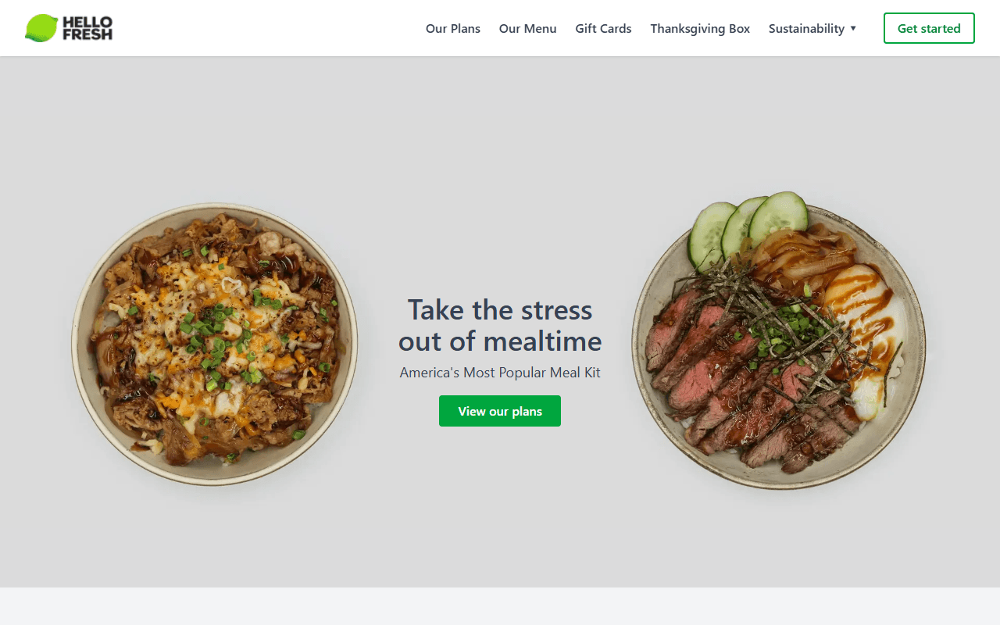

# HelloFresh React Clone – full stack (practice project)

[](https://codelady-ship.github.io/hello-fresh-with-react/)

A multi-page clone of the HelloFresh meal-kit website, built with React, React Router, Vite and Tailwind CSS, plus a **Node.js + Express + MongoDB API** (`backend/`, deployable to Render) for plans, recipes, plan subscriptions and gift cards. If the API is not reachable, the site uses its bundled data and the forms run in demo mode, so the static GitHub Pages site never breaks.

> **Practice clone.** This is a learning project. It is not affiliated with, endorsed by or connected to HelloFresh. Plans, prices and gift cards are examples only: no payment is taken and nothing is delivered. The HelloFresh name, logo, icons and recipe photos belong to HelloFresh. The hero, community and "Seared Steak" photos are free stock photos from Unsplash (see [Photo credits](#photo-credits)); the clone shows no photos of real customers or celebrities.
>
> 🇦🇿 Təlim layihəsi: HelloFresh saytının React, Vite və Tailwind CSS ilə hazırlanmış çoxsəhifəli full-stack klonu: Express + MongoDB API planları, reseptləri, abunələri və hədiyyə kartlarını saxlayır; server əlçatan olmayanda sayt demo rejimdə işləyir.



## Features

- **Home page:** hero, "Why HelloFresh?", box contents, plan carousel with arrow buttons, community photos, FAQ accordion
- **Our Plans:** choose a plan, number of people and meals per week; the summary calculates the weekly total. With the API online, **"Select this plan" saves a subscription** (name, email, optional gift card code). The server recalculates the price and returns a reference like `HF-3F9A1C`. The subscription is created first and the gift card is debited atomically afterwards; if the balance was already spent, the subscription is rolled back
- **Our Menu:** recipes loaded from the API (bundled copy offline) and filtered by plan
- **Gift Cards:** form with a live gift card preview. With the API online it **creates a demo gift card code** (e.g. `GIFT-1A2B3C4D`) that can be redeemed on the first box in Our Plans. There is no payment step in this practice project, so every card is marked `demo: true`; a real shop would only create a card after a successful payment
- **Thanksgiving Box:** seasonal box menu and "how it works" steps
- **Sustainability:** three topic pages (packaging & recycling, seasonal ingredients, less food waste)
- Responsive header with a hamburger menu and a Sustainability dropdown (closes on navigation, outside click and Escape)
- Page titles per route, one `h1` per page, alt text on all images, WebP images, favicon, Open Graph tags, `robots.txt`, `sitemap.xml`

## Photo credits

Free photos from [Unsplash](https://unsplash.com), used under the [Unsplash License](https://unsplash.com/license). They were cropped and converted to WebP.

| File | Photo | Photographer |
|---|---|---|
| `public/images/page1.webp` (hero, left bowl) | [Bowl of food on a white table](https://unsplash.com/photos/a-bowl-of-food-on-a-white-table-KwGoCJGwbCs) | [Xavier Chng](https://unsplash.com/@cohesionsingapore) |
| `public/images/page1.webp` (hero, right bowl) | [Plate of food with meat, vegetables and sauce](https://unsplash.com/photos/a-plate-of-food-with-meat-vegetables-and-sauce-o3Og5MYceTI) | [Xavier Chng](https://unsplash.com/@cohesionsingapore) |
| `public/images/steak-bowl.webp` | [Black bowl filled with meat and rice](https://unsplash.com/photos/a-black-bowl-filled-with-meat-and-rice-JJWd8lxX5Kk) | Markus Winkler |
| `public/images/page5-1.webp` | [Person slicing vegetable](https://unsplash.com/photos/person-slicing-vegetable-uB7q7aipU2o) | Jonathan Borba |
| `public/images/page5-2.webp` | [Person holding black frying pan with cooked food](https://unsplash.com/photos/person-holding-black-frying-pan-with-cooked-food-UjIkvPvfsFY) | Carlos Fernández |
| `public/images/page5-3.webp` | [People mixing items on bowl](https://unsplash.com/photos/people-mixing-items-on-bowl-XiWtCLWK5K8) | Annie Spratt |
| `public/images/page5-4.webp` | [Hands arranging fresh cherry tomatoes on a wooden board](https://unsplash.com/photos/hands-arranging-fresh-cherry-tomatoes-on-a-wooden-board-Yy8FETHf8lo) | [Ahmet Koç](https://unsplash.com/@ahmetkoc) |

## Tech stack

- **Frontend:** React 19, React Router 7 (`HashRouter`), Vite 6, Tailwind CSS 4, ESLint.
- **Backend:** Node.js 20+, Express 5, MongoDB with Mongoose 8, zod validation, JWT admin auth, CORS allow-list, rate limiting.
- **Tests:** `node:test` + supertest on an in-memory MongoDB.
- **Hosting:** GitHub Pages (frontend), Render free web service (API, `render.yaml`), MongoDB Atlas free cluster.

## REST API

| Method | Path | Access | Description |
|---|---|---|---|
| GET | `/api/health` | public | Status and database connection |
| GET | `/api/plans` | public | Active plans (`id` = slug, `pricePerServing`) |
| GET | `/api/recipes?plan=veggie&maxTime=30&tag=Quick` | public | Recipes with optional filters |
| GET | `/api/recipes/:slug` | public | One recipe |
| POST | `/api/subscriptions` | public (rate limited) | `{ plan, people, meals, name, email, giftCode? }` → `201 { reference, weeklyTotal, giftApplied, firstBoxTotal, ... }` |
| POST | `/api/gift-cards` | public (rate limited) | `{ amount: 25|50|75|100, to, from, message }` → `201 { code, amount }` |
| GET | `/api/gift-cards/:code` | public (rate limited) | Amount and remaining balance |
| POST | `/api/auth/login` | public (rate limited) | `{ email, password }` → `{ token }` |
| GET / POST / PUT / DELETE | `/api/admin/plans[/:slug]`, `/api/admin/recipes[/:slug]` | admin | Manage the catalogue |
| GET / PATCH | `/api/admin/subscriptions[/:reference]` | admin | List subscriptions, change status |
| GET | `/api/admin/gift-cards` | admin | List gift cards |

Admin calls need `Authorization: Bearer <token>`. `src/data/site.js` is both the seed for the database and the offline copy for the frontend.

## Run locally

```bash
git clone https://github.com/codelady-ship/hello-fresh-with-react.git
cd hello-fresh-with-react
npm install
npm run dev        # http://localhost:5173/
npm run build      # production build in dist/ (base: /hello-fresh-with-react/)
npm run preview    # preview the production build
```

API (needs MongoDB: a free Atlas cluster or a local `mongod`):

```bash
cd backend
cp .env.example .env   # fill MONGODB_URI, JWT_SECRET, ADMIN_EMAIL, ADMIN_PASSWORD
npm install
npm run dev            # http://localhost:4000, empty collections are seeded from src/data/site.js
npm test               # API tests on an in-memory MongoDB
```

Open the frontend with `?api=` (honoured only on `localhost`/`127.0.0.1`, so a crafted link cannot redirect the live forms), e.g. `http://localhost:5173/?api=http://localhost:4000#/OurPlans`.

## Deployment

The site is hosted on GitHub Pages from the `gh-pages` branch. The build reads `VITE_API_URL` from `.env.production` (empty = static demo).

```bash
npm run deploy     # = npm run build && npx gh-pages@6 -d dist --nojekyll
```

- `vite.config.js` sets `base: '/hello-fresh-with-react/'` for builds, so assets resolve under the repository sub-path.
- Routing uses `HashRouter` (URLs look like `/hello-fresh-with-react/#/OurPlans`). GitHub Pages only serves real files, so with `BrowserRouter` a refresh on `/OurPlans` returned HTTP 404. With the hash, every route loads `index.html` and deep links work.
- **API:** create a free MongoDB Atlas M0 cluster (Network Access `0.0.0.0/0`), then on Render choose *New → Blueprint* and pick this repo. `render.yaml` creates the free web service `hello-fresh-clone-api` from `backend/`; fill `MONGODB_URI`, `ADMIN_EMAIL` and `ADMIN_PASSWORD` (`JWT_SECRET` is generated). The first start seeds plans and recipes. Put the Render URL into `.env.production` and run `npm run deploy` again. The free service sleeps after 15 idle minutes; during the cold start the site shows the bundled data.
- `public/404.html` redirects old links such as `/hello-fresh-with-react/OurPlans` to the matching `#/OurPlans` route.

## Project structure

```
src/
  api.js                    API client (8 s timeout) and useCatalog() hook with offline fallback
  data/site.js              plans, recipes, sustainability topics, asset() helper (also the API seed)
  komponents/
    layout/                 Header, Footer and the home page sections (PagesPart)
    pages/                  one folder per route
    ui/                     shared page header, section, button, hooks (title, toast)
    RouterPart/             route table
public/images/              images (photos in WebP)
backend/                    Express + MongoDB API (models, routes, seed, tests)
```

## What I learned

- Building a REST API with Express and Mongoose, and calculating prices and gift card balances on the server instead of trusting the browser.
- Keeping a static frontend working when its API sleeps: a timeout and a bundled fallback.
- Splitting a page into reusable React components and sharing data from one file
- Managing UI state with `useState` (plan builder, filters, accordion, menus) and side effects with `useEffect`
- How client-side routing interacts with static hosting, and why `HashRouter` avoids 404s on GitHub Pages
- Configuring Vite's `base` for a sub-path deployment
- Accessibility basics: `aria-expanded`, labels for form fields, alt text and one `h1` per page
- Compressing images (every photo is a WebP under 200 KB)
